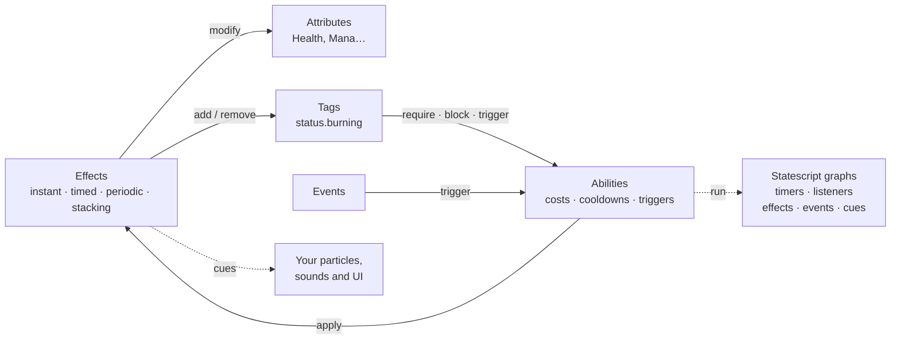

# Forge Gameplay System

[](https://github.com/gamesmiths-guild/forge/actions/workflows/validate-project.yml)
[](https://www.nuget.org/packages/Gamesmiths.Forge)
[](LICENSE)

**A gameplay framework for C#, bringing Unreal’s Gameplay Ability System concepts to any engine.** Attributes, effects, abilities, gameplay tags, events, cues and visual ability scripting, with no engine dependency.

Every game rebuilds the same machinery: Health that can't go below zero, a poison that ticks, a buff that stacks to three, a fireball with a mana cost and a cooldown, a shield that blocks one kind of damage. Forge gives you that machinery once, as data and small interfaces, so it works the same in Unity, Godot, a custom engine, a server or a unit test.

```csharp
// A burn: -5 Health every half second, until removed.
var burning = new EffectData(
    "Burning",
    new DurationData(DurationType.Infinite),
    [new Modifier("HeroAttributes.Health", ModifierOperation.FlatBonus,
        new ModifierMagnitude(MagnitudeCalculationType.ScalableFloat, new ScalableFloat(-5)))],
    periodicData: new PeriodicData(new ScalableFloat(0.5f), true, PeriodInhibitionRemovedPolicy.ResetPeriod));

hero.EffectsManager.ApplyEffect(new Effect(burning, new EffectOwnership(hero, hero)));

// Your game loop drives time; Forge never reads a clock.
hero.EffectsManager.UpdateEffects(deltaTime);
```

## How it fits together



Attributes and tags only change through effects. That one rule is what lets every change be timed, stacked, blocked by an immunity, reacted to and shown to the player in the same way.

## Systems

- **[Attributes](docs/attributes.md)**: integer stats with min/max, layered modifiers and calculation channels, grouped in attribute sets.
- **[Effects](docs/effects/README.md)**: instant, timed and infinite effects, with [modifiers](docs/effects/modifiers.md), [periodic execution](docs/effects/periodic.md), [stacking](docs/effects/stacking.md), [components](docs/effects/components/README.md) and [custom calculators](docs/effects/calculators.md).
- **[Tags](docs/tags.md)**: hierarchical gameplay tags with queries, requirements and immunity.
- **[Abilities](docs/abilities.md)**: granting, activation, costs, cooldowns, tag rules, triggers and instancing.
- **[Events](docs/events.md)**: tag-routed gameplay events, optionally strongly typed, that can trigger abilities.
- **[Cues](docs/cues.md)**: presentation hooks that keep visuals and audio out of gameplay code.
- **[Statescript](docs/statescript/README.md)**: ability behavior as a graph of nodes and resolvers, built in code or in an engine's visual editor.

## Get started

```shell
dotnet add package Gamesmiths.Forge
```

Then follow the **[Quick Start](docs/quick-start.md)**: a hero with Health and Mana, a burning effect, a cue and a heal ability with a cost and a cooldown, in about ten minutes. Its code runs in this repository's test suite.

After that: the [guides](docs/guides/README.md) for recipes and the [documentation overview](docs/README.md) for how each system works.

### Using an engine

Forge runs anywhere .NET Standard 2.1 or .NET 8 runs. Implement `IForgeEntity` on your game objects and call two update methods from your loop.

Using **Godot**? [Forge for Godot](https://github.com/gamesmiths-guild/forge-godot) adds nodes, Inspector resources, a tags editor and a visual Statescript editor, plus playable samples.

## Installation

Forge targets **.NET Standard 2.1**, for broad engine compatibility, and **.NET 8**.

- **NuGet (recommended):** `dotnet add package Gamesmiths.Forge`, or search for `Gamesmiths.Forge` in your IDE's package manager.
- **Precompiled:** download the `.dll` from the [Releases](https://github.com/gamesmiths-guild/forge/releases) page.
- **From source:** clone this repository and reference `Forge/Forge.csproj` from your solution.

The package ships with [Source Link](https://learn.microsoft.com/en-us/dotnet/standard/library-guidance/sourcelink) and symbols, so you can step into Forge's code while debugging.

## Project status

⚠️ **Work in progress.** Forge is under active development and its API may still change between releases.

**Available:** attributes, effects (with stacking, periodic execution, components, custom calculators and executions), tags, abilities, events, cues, Statescript with its node and resolver library, and runtime validation.

**Planned:** multiplayer, with network replication and prediction for all systems.

## Contributing

This project is not currently accepting contributions as it's still in early development. If you have suggestions or questions, feel free to reach out through GitHub issues or discussions.

## License

Copyright © Gamesmiths Guild. See [LICENSE](LICENSE) for details.
