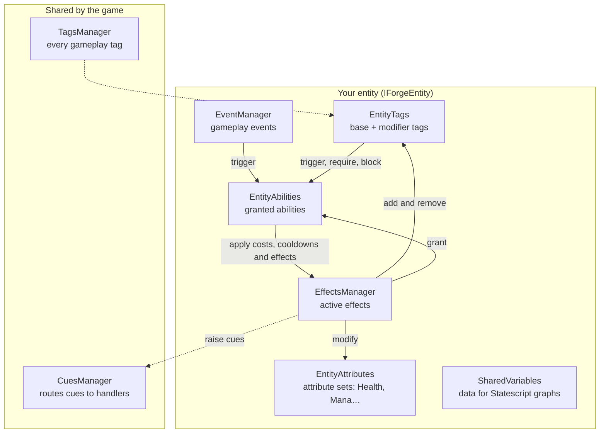

# Forge Documentation

Forge is an engine-agnostic gameplay framework in C#, inspired by Unreal Engine's Gameplay Ability System. These pages explain how its systems work and how to use them from code.

**New here?** Read the [Quick Start](quick-start.md) first. It builds a working hero with Health, a burning effect and a heal ability in about ten minutes, and everything after it builds on those ideas.

## How the pieces fit

Everything that takes part in gameplay is an **entity**: any object of yours that implements `IForgeEntity`. Each entity owns one of each manager below, and two managers are shared by the whole game.



The one rule that holds it together: **attributes and tags change through effects**. A sword hit, a poison, a level-up bonus, an ability's mana cost and its cooldown are all effects. Because of that, every change can be stacked, timed, made immune to, reacted to and shown to the player in the same way.

## Systems

| System | What it does | Start with |
| --- | --- | --- |
| [Attributes](attributes.md) | Integer stats with a minimum, a maximum and layered modifiers, grouped in attribute sets. | [Attribute values are integers](attributes.md#attribute-values-are-integers) |
| [Effects](effects/README.md) | The only way to change attributes and tags: instant, timed or infinite, optionally periodic and stacking. | [Modifiers](effects/modifiers.md), [Duration](effects/duration.md) |
| [Tags](tags.md) | Hierarchical labels (`status.burning`) used for matching, requirements, immunity and routing. | |
| [Abilities](abilities.md) | Things an entity can do: granted, activated, with costs, cooldowns, tag rules and instancing. | [Observing abilities](abilities.md#observing-abilities) |
| [Events](events.md) | Tag-routed gameplay messages, optionally strongly typed, that can trigger abilities. | |
| [Cues](cues.md) | Presentation hooks: effects raise cues, your handlers turn them into particles and sound. | |
| [Input](input.md) | One frame of a player's input per tick, abilities that activate from input actions, and graphs that read input. | [Ability input bindings](input.md#ability-input-bindings), [Reading input in graphs](input.md#reading-input-in-graphs) |
| [Statescript](statescript/README.md) | Ability behavior as a graph of nodes, built in code or in an engine's visual editor. | [Subgraphs](statescript/subgraphs.md) |

Going deeper into effects: [Stacking](effects/stacking.md), [Periodic effects](effects/periodic.md), [Components](effects/components/README.md) and [Custom calculators and executions](effects/calculators.md).

Going deeper into Statescript: the [node library](statescript/nodes/README.md), [resolvers](statescript/resolvers/README.md), [variables and data](statescript/variables.md), [ability integration](statescript/ability-integration.md) and [custom resolvers](statescript/custom-resolvers.md).

Going deeper into the simulation: the [simulation tick](simulation.md) and [rollback](rollback.md).

## Guides

Task-focused walkthroughs, with code that runs in the test suite: [effect recipes](guides/effect-recipes.md), [extending effects](guides/extending-effects.md), [cues and events](guides/cues-and-events.md), [ability recipes](guides/ability-recipes.md) and [Statescript in code](guides/statescript-in-code.md). See the [guides index](guides/README.md).

## Design principles

1. **Composition over inheritance.** Systems attach to your objects through `IForgeEntity`; your class hierarchy stays yours.
2. **Data-driven.** Effects and abilities are definitions (`EffectData`, `AbilityData`) that can be authored as data and shared.
3. **Modular.** Use attributes and effects alone, or add abilities, events, cues and Statescript as you need them.
4. **Time is an argument.** Forge never reads a clock; your loop passes the delta, so real-time, turn-based and simulated games work alike.
5. **Deterministic.** Integer attributes, explicit time, a seeded per-tick random and fixed update orders keep results predictable, with networking and replays in mind. See [Simulation Tick](simulation.md) and [Rollback](rollback.md).

## Validation and Debugging

Forge includes a runtime validation system (the `Validation` class) that catches misconfigurations and logic errors during development, in editors and in tests.

- Validation is **disabled** by default.
- Enable it with `Validation.Enabled = true;` in your editor, test or debug environment.
- A failed validation throws a `ValidationException` with an explanatory message.
- Leave it disabled in shipped builds for performance.

```csharp
Validation.Enabled = true; // Enable validation (e.g., in editor)
Validation.Assert(someCondition, "Message if failed.");
```

The NuGet package ships with [Source Link](https://learn.microsoft.com/en-us/dotnet/standard/library-guidance/sourcelink) and symbols, so you can step into Forge's source while debugging.

## Using Forge in an engine

Forge has no engine dependency. Integrations wrap it in the engine's own idioms:

- **Godot:** [Forge for Godot](https://github.com/gamesmiths-guild/forge-godot) adds nodes, Inspector resources, a tags editor and a visual Statescript graph editor.
- **Anything else:** implement `IForgeEntity` on your objects and advance each one with `EntitySimulation.Tick` from your loop, as the [Quick Start](quick-start.md#5-drive-time) shows. See [Simulation Tick](simulation.md).
