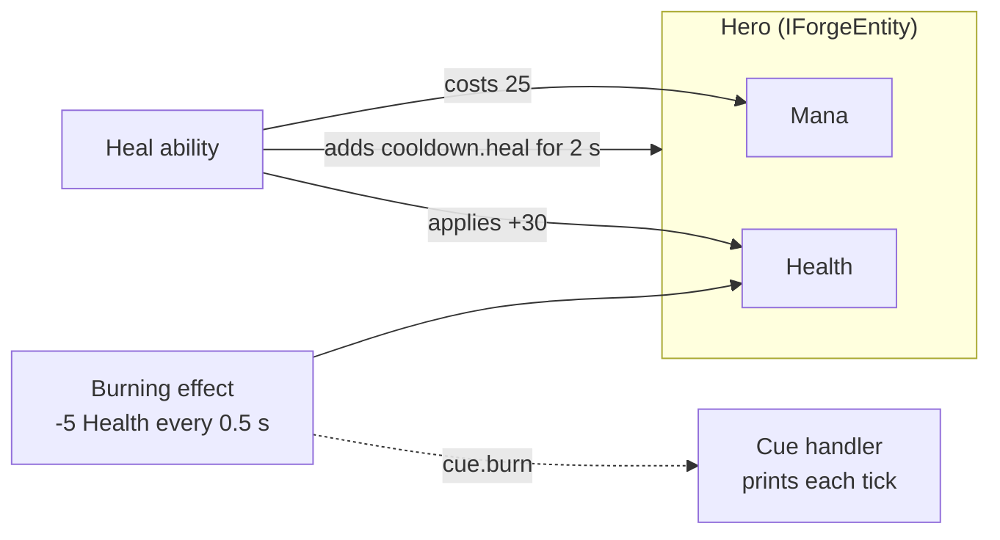

# Quick Start

In about ten minutes of reading you'll build a hero with Health and Mana, set them on fire, and give them a heal with a mana cost and a cooldown. It's all plain C#, so it runs the same in any engine, in a console app or in a test.

Everything here is the code of [`QuickStartTests`](../Forge.Tests/Samples/QuickStartTests.cs), which runs in CI. If a snippet drifts from the library, the build says so.

Using Godot? [Forge for Godot](https://github.com/gamesmiths-guild/forge-godot) builds the same scene with nodes, resources and a visual graph editor; its [Quick Start](https://github.com/gamesmiths-guild/forge-godot/blob/main/docs/quick-start.md) builds this same burning hero and heal in the editor.

## What you'll build



## 1. Install

```shell
dotnet add package Gamesmiths.Forge
```

Forge targets .NET Standard 2.1 and .NET 8. See [Installation](../README.md#installation) for other options.

## 2. Create the managers

Two objects are shared by the whole game. The `TagsManager` knows every gameplay tag, and tags are dot-separated names like `cue.burn` that Forge uses to label, match and route things. The `CuesManager` routes cues, Forge's presentation events, to whatever draws them.

```csharp
var tagsManager = new TagsManager(["cue.burn", "cue.heal", "cooldown.heal"]);
var cuesManager = new CuesManager();
```

## 3. Define the hero

Stats live in an **attribute set**. Every attribute has a current, minimum and maximum value, and all of them are integers by design; see [Attribute Values Are Integers](attributes.md#attribute-values-are-integers).

```csharp
public class HeroAttributes : AttributeSet
{
    public EntityAttribute Health { get; }

    public EntityAttribute Mana { get; }

    public HeroAttributes()
    {
        // Current, minimum and maximum values.
        Health = InitializeAttribute(nameof(Health), 100, 0, 100);
        Mana = InitializeAttribute(nameof(Mana), 100, 0, 100);
    }
}
```

Anything that takes part in gameplay implements `IForgeEntity`. It holds one of each of Forge's managers. In an engine this is usually your character class, or a component on it.

```csharp
public class Hero : IForgeEntity
{
    public EntityAttributes Attributes { get; }

    public EntityTags Tags { get; }

    public EffectsManager EffectsManager { get; }

    public CuesManager CuesManager { get; }

    public EntityAbilities Abilities { get; }

    public EventManager Events { get; }

    public Variables SharedVariables { get; } = new();

    public Hero(TagsManager tagsManager, CuesManager cuesManager)
    {
        Attributes = new EntityAttributes(this, new HeroAttributes());
        Tags = new EntityTags(new TagContainer(tagsManager));
        EffectsManager = new EffectsManager(this, cuesManager);
        CuesManager = cuesManager;
        Abilities = new EntityAbilities(this);
        Events = new EventManager();
    }
}
```

```csharp
var hero = new Hero(tagsManager, cuesManager);

int health = hero.Attributes["HeroAttributes.Health"].CurrentValue; // 100
```

Attributes are addressed as `"SetName.AttributeName"`.

## 4. Set it on fire

Attributes change only through **effects**. An effect is data: what it modifies, for how long, how often. This one takes 5 Health every half second until it's removed, and announces each tick with the `cue.burn` cue.

```csharp
var burning = new EffectData(
    "Burning",
    new DurationData(DurationType.Infinite),
    [
        new Modifier(
            "HeroAttributes.Health",
            ModifierOperation.FlatBonus,
            new ModifierMagnitude(MagnitudeCalculationType.ScalableFloat, new ScalableFloat(-5))),
    ],
    periodicData: new PeriodicData(
        Period: new ScalableFloat(0.5f),
        ExecuteOnApplication: true,
        PeriodInhibitionRemovedPolicy: PeriodInhibitionRemovedPolicy.ResetPeriod),
    cues:
    [
        new CueData(
            CueTags: tagsManager.RequestTagContainer(["cue.burn"]),
            MinValue: 0,
            MaxValue: 100,
            MagnitudeType: CueMagnitudeType.AttributeValueChange,
            MagnitudeAttribute: "HeroAttributes.Health"),
    ]);
```

`EffectData` is a reusable definition. Applying it creates a live instance on an entity:

```csharp
ActiveEffectHandle? fire = hero.EffectsManager.ApplyEffect(
    new Effect(burning, new EffectOwnership(hero, hero)));
```

## 5. Drive time

Forge never reads a clock. Your game loop advances each entity by a step of the length it chooses, and timed and periodic effects, cooldowns and running abilities advance by exactly that much:

```csharp
long tick;

void Tick(Hero hero, float deltaTime)
{
    // The tick number counts up by one per step.
    EntitySimulation.Tick(hero, ++tick, deltaTime);
}
```

Two seconds in the fire is five ticks: one on application, then one every half second.

```csharp
Tick(hero, 2f);
// Health: 75

hero.EffectsManager.RemoveEffect(fire!);
Tick(hero, 2f);
// Health: still 75
```

Because time is an argument rather than a clock, the same code runs turn-based (call `Tick(hero, 1f)` once per turn), in a fixed-step simulation, or in a unit test. [Simulation Tick](simulation.md) shows what a tick runs, and in which order.

## 6. Show it with a cue

Gameplay code never draws anything. An effect raises **cues**, and **cue handlers** decide what they look like. In an engine a handler spawns particles or plays a sound; here it prints.

```csharp
public class PrintCueHandler(string name) : ICueHandler
{
    public void OnApply(IForgeEntity? target, CueParameters? parameters) => Console.WriteLine($"{name} starts");

    public void OnExecute(IForgeEntity? target, CueParameters? parameters) =>
        Console.WriteLine($"{name}: {parameters?.Magnitude}");

    public void OnUpdate(IForgeEntity? target, CueParameters? parameters)
    {
    }

    public void OnRemove(IForgeEntity? target, bool interrupted) => Console.WriteLine($"{name} ends");
}
```

Register it once at startup, before any effect that raises the cue is applied. Here that means before the `ApplyEffect` call in step 4:

```csharp
cuesManager.RegisterCue(Tag.RequestTag(tagsManager, "cue.burn"), new PrintCueHandler("Burn"));
```

```text
Burn starts
Burn: -5
Burn: -5
Burn: -5
Burn: -5
Burn: -5
Burn ends
```

`MagnitudeType: AttributeValueChange` is why each tick reports `-5`: the cue carries the Health that was actually lost. See [Cues](cues.md).

## 7. Give the hero a heal

An **ability** is something an entity can do. Its cost and cooldown are effects too: an instant Mana change, and a timed effect that adds the `cooldown.heal` tag. While the tag is present, the ability can't activate.

```csharp
var heal = new EffectData(
    "Heal",
    new DurationData(DurationType.Instant),
    [
        new Modifier(
            "HeroAttributes.Health",
            ModifierOperation.FlatBonus,
            new ModifierMagnitude(MagnitudeCalculationType.ScalableFloat, new ScalableFloat(30))),
    ]);

var healCost = new EffectData(
    "Heal Cost",
    new DurationData(DurationType.Instant),
    [
        new Modifier(
            "HeroAttributes.Mana",
            ModifierOperation.FlatBonus,
            new ModifierMagnitude(MagnitudeCalculationType.ScalableFloat, new ScalableFloat(-25))),
    ]);

var healCooldown = new EffectData(
    "Heal Cooldown",
    new DurationData(
        DurationType.HasDuration,
        new ModifierMagnitude(MagnitudeCalculationType.ScalableFloat, new ScalableFloat(2))),
    effectComponents: [new ModifierTagsEffectComponent(tagsManager.RequestTagContainer(["cooldown.heal"]))]);
```

What the ability *does* is its **behavior**. This one pays the cost, applies the heal and ends:

```csharp
public class HealBehavior(EffectData heal) : IAbilityBehavior
{
    public void OnStarted(AbilityBehaviorContext context)
    {
        // Pays the cost and starts the cooldown; false when the hero cannot afford it.
        if (context.AbilityHandle.TryCommitAbility())
        {
            context.Owner.EffectsManager.ApplyEffect(
                new Effect(heal, new EffectOwnership(context.Owner, context.Owner)));
        }

        context.InstanceHandle.End();
    }

    public void OnEnded(AbilityBehaviorContext context)
    {
    }
}
```

```csharp
var healAbility = new AbilityData(
    name: "Heal",
    costEffect: healCost,
    cooldownEffects: [healCooldown],
    instancingPolicy: AbilityInstancingPolicy.PerEntity,
    behaviorFactory: () => new HealBehavior(heal));
```

A behavior can also be a [Statescript](statescript/README.md) graph instead of a class. That's how the Godot editor builds this same heal visually.

## 8. Grant and use it

An entity has to be **granted** an ability before it can activate it. Keep the handle and call `TryActivate` when the player presses the key:

```csharp
AbilityHandle healHandle = hero.Abilities.GrantAbilityPermanently(
    healAbility,
    abilityLevel: 1,
    levelOverridePolicy: LevelComparison.None,
    sourceEntity: hero);

healHandle.TryActivate(out AbilityActivationFailures failures);
// true. Health: 100 (75 + 30, clamped to the maximum). Mana: 75.

healHandle.TryActivate(out failures);
// false. failures has AbilityActivationFailures.Cooldown.

Tick(hero, 2f);
healHandle.TryActivate(out failures);
// true again. Mana: 50.
```

`failures` tells you why an activation was refused: a cooldown, missing resources, a blocking tag. That's what you'd show as "Not enough mana" in your UI.

## What you used

- **Attributes** in an `AttributeSet`, owned by an `IForgeEntity`.
- **Effects**: instant, timed, and infinite with a period, all built from `EffectData`, with modifiers or a component.
- **Tags**: as cue keys and as a cooldown marker.
- **Cues**: presentation kept out of gameplay code.
- **Abilities**: a behavior with a cost and a cooldown, granted and activated through a handle.
- **Time**: one `EntitySimulation.Tick` call per entity and step, from your game loop.

## Where to go next

- [Guides](guides/README.md): effect recipes (stacking poison, unique buffs, tag immunity), extending effects with components, calculators and executions, cues and events, ability triggers, and Statescript in code.
- The concept pages: [Attributes](attributes.md), [Effects](effects/README.md), [Tags](tags.md), [Abilities](abilities.md), [Cues](cues.md), [Events](events.md) and [Statescript](statescript/README.md).
- Drive your UI from gameplay state with the [attribute](attributes.md#from-outside-the-attributeset), [tag](tags.md#reacting-to-tag-changes), [effect](effects/README.md#observing-effects) and [ability](abilities.md#observing-abilities) change notifications.
- Catch configuration mistakes early with [Validation and Debugging](README.md#validation-and-debugging).
